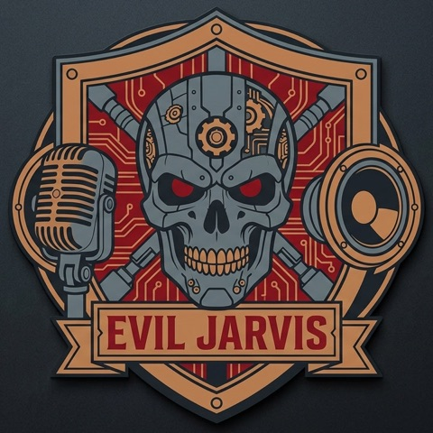

<p align="center"></p>

# Evil Jarvis

Turn a Halloween prop into a character that talks back. Put a microphone and a
speaker inside it, and visitors can have a conversation with it. Everything runs
on your own machine, so there is no cloud service or account to set up.

Characters live in TOML files where you set the personality, example lines,
voice and effects. Two come built in, and both speak Polish and English:

- `clown`: a creepy clown
- `jarvis`: a sinister smart-home assistant

## Requirements

- Apple Silicon Mac, or Linux with an NVIDIA GPU (CPU-only works, slowly)
- Python 3.11+ and [uv](https://docs.astral.sh/uv/)
- PortAudio and ffmpeg: `brew install portaudio ffmpeg` or `sudo apt install libportaudio2 ffmpeg`

## Install

```bash
uv sync --extra models --extra voice
```

On Linux, rebuild llama.cpp with CUDA. faster-whisper uses the GPU when CUDA and
cuDNN are installed (versions in its README), and falls back to Whisper `small`
on the CPU otherwise.

```bash
CMAKE_ARGS="-DGGML_CUDA=on" uv sync --extra models --extra voice --reinstall-package llama-cpp-python
```

Then download the models and voices, about 6 GB into `models/`:

```bash
uv run evil-jarvis --download
```

`--download` fetches what the given options need and then checks the setup.
Pass the options you plan to run with, for example
`--persona jarvis --language auto --download`, so their voices come too.
`--check` runs only the check.

## Usage

Start the default character, the clown. It listens on the default microphone
and answers through the default speaker:

```bash
uv run evil-jarvis
```

Pick another character:

```bash
uv run evil-jarvis --persona jarvis
```

Answer in whichever language each visitor speaks, instead of only the
persona's language:

```bash
uv run evil-jarvis --language auto
```

Try a persona without a microphone or speaker. You type lines and the replies
are printed:

```bash
uv run evil-jarvis --text-only --no-speech
```

Each run prints which models, devices and voices it uses. Ctrl-C quits.

The most useful options are below. `uv run evil-jarvis --help` lists all of them.

| Option | Purpose |
|---|---|
| `--persona NAME\|FILE` | Built-in persona or a `.toml` path. `--list-personas` lists them. |
| `--language CODE` | `pl`, `en`, ... or `auto`. Default from the persona. |
| `--voice`, `--voice-effect`, `--prosody`, `--piper-speed` | Override the persona's voice. Effects: `clean`, `metallic`, `metallic-demon`. Prosody: `plain`, `maniacal`. |
| `--llm-model PATH` | Any GGUF instruct model. |
| `--stt-engine` | `mlx` (Apple GPU) or `faster-whisper`. Chosen automatically. |
| `--memory-seconds N` | Conversation memory, cleared after N seconds of silence. Default 90, `0` disables it. |
| `--input-device`, `--output-device` | Audio devices. `--list-devices` lists them. |
| `--silence-ms`, `--threshold-multiplier` | Voice detection tuning. |
| `--env-file PATH` | Environment file. Default `.env` in the project. |

## Personas

Copy `src/evil_jarvis/persona/builtin/clown.toml`, which documents every
setting, and run it with `--persona path/to/file.toml`. Unknown settings are
rejected when the file loads.

```toml
name = "witch"
display_name = "Witch"
language = "en"

[voice]
voice = "en_US-lessac-high"       # any Piper voice in models/piper
effect = "metallic"
prosody = "plain"

[voice.by_language]               # optional voice per language
pl = "pl_PL-darkman-medium"

[languages.default]               # required, used for languages without their own section
system_prompt = "You are a witch..."
examples = [{ visitor = "Who are you?", reply = "Your next ingredient." }]
attempts = 3                      # regenerate rejected replies, then stay silent
max_words = 25
checks = ["no_symbols", "no_stage_directions", "no_echo", "no_repeat"]
```

Available checks: `latin_only`, `no_symbols`, `no_stage_directions`,
`not_english`, `no_echo`, `no_echo_opening`, `no_example_copy`, `no_repeat`. Empty replies are
always rejected.

## Telemetry

Off by default. To send metrics to [WildEdge](https://wildedge.dev), set
`WILDEDGE_DSN` in `.env`:

```bash
echo 'WILDEDGE_DSN=...' > .env
```

By default it sends only timings, token counts, model metadata and outcomes.
`--wildedge-capture text` also uploads transcripts and replies, and `audio` also
uploads voice clips. If you capture, tell visitors they are being recorded.

## Development

```bash
uv run pytest
uv run ruff format .
uv run ruff check --fix .
```

Tests need no models or audio devices. Ruff settings are in `pyproject.toml`.
Layout:

```text
src/evil_jarvis/
  cli.py           options and wiring
  conversation.py  listen, transcribe, reply, speak
  stt/             speech to text (mlx-whisper, faster-whisper)
  llm/             replies (llama.cpp)
  tts/             Piper voices, effects, prosody, playback
  persona/         persona loading, reply checks, built-in personas
  bench/asr.py     speech recognition benchmark (jarvis-asr-bench)
```

`benchmarks/` holds model comparisons and voice sample scripts.
